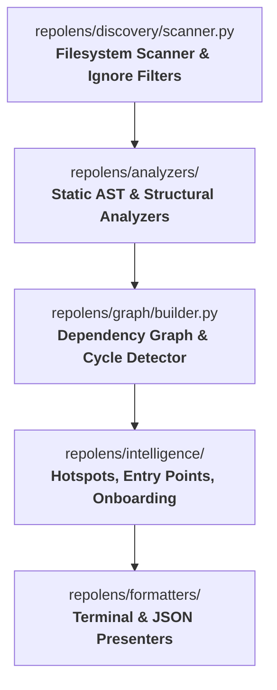

# Contributing to RepoLens

Thank you for your interest in contributing to RepoLens!

RepoLens is built to help developers understand unfamiliar repositories quickly, using **deterministic evidence** rather than speculative scores or external AI calls.

---

## Code of Conduct

We are committed to providing a friendly, safe, and welcoming environment for all contributors. Please treat everyone with respect and kindness.

---

## Development Setup

RepoLens is written in Python 3.10+ and requires minimal dependencies:

```bash
# 1. Clone the repository
git clone https://github.com/deswanth12/repolens.git
cd repolens

# 2. Create and activate a virtual environment
python -m venv .venv
# On Windows (PowerShell):
.\.venv\Scripts\Activate.ps1
# On Windows (Command Prompt):
.\.venv\Scripts\activate.bat
# On Linux / macOS:
source .venv/bin/activate

# 3. Install dependencies and RepoLens in editable mode
pip install -e ".[dev]"

# 4. Run the test suite
pytest -v

# 5. Check code formatting and style
ruff check .
ruff format --check .

# 6. Run static type checking
mypy repolens
```

---

## Architecture & Subsystems

RepoLens is structured as a deterministic pipeline:



| Subsystem | Location | Responsibility |
| :--- | :--- | :--- |
| **Discovery** | `repolens/discovery/` | File traversal, `.gitignore` / `.repolensignore` filtering, binary inspection, and path traversal / symlink boundary enforcement. |
| **Analyzers** | `repolens/analyzers/` | AST parsing (`PythonAnalyzer`), Tree-sitter extraction (`JsTsAnalyzer`), and fallback regex extraction (`FallbackAnalyzer`). **Zero runtime execution**. |
| **Graph** | `repolens/graph/` | Directed dependency graph construction, in-degree/out-degree calculation, and iterative DFS cycle detection. |
| **Intelligence** | `repolens/intelligence/` | Hotspot scoring, architecture layer categorization, entry-point candidate discovery, and onboarding reading order generation. |
| **Formatters** | `repolens/formatters/` | Rich terminal layout and machine-readable JSON rendering. |
| **CLI & Engine** | `repolens/cli.py`, `repolens/engine.py` | Command-line option parsing, pipeline orchestration, and `--format text|json` output handling. |

---

## Adding a New Language Analyzer

RepoLens uses a pluggable analyzer architecture:

1. Subclass `BaseAnalyzer` in `repolens/analyzers/`:
   ```python
   from pathlib import Path
   from repolens.analyzers.base import BaseAnalyzer
   from repolens.models import FileRecord, ModuleAnalysis

   class MyLanguageAnalyzer(BaseAnalyzer):
       @property
       def language_name(self) -> str:
           return "MyLang"

       def can_analyze(self, file_record: FileRecord) -> bool:
           return file_record.language == "MyLang" and not file_record.is_binary

       def analyze(self, file_path: Path, rel_path: str) -> ModuleAnalysis:
           # Extract symbols, imports, exports statically without executing code!
           ...
   ```
2. Register the analyzer in `repolens/engine.py`.
3. Add a test in `tests/test_mylang_analyzer.py` and a fixture under `tests/fixtures/`.
4. Ensure no code execution occurs during analysis!

---

## Pull Request Guidelines

Before opening a pull request, please verify your changes pass all quality gates locally:

```bash
# 1. Run full test suite
pytest -v

# 2. Verify linting and formatting
ruff check .
ruff format --check .

# 3. Verify static types
mypy repolens
```

### Review Principles
1. **Evidence over speculation**: Every score or recommendation must point to deterministic code evidence.
2. **Zero execution**: Never execute user repository code or import analyzed files.
3. **Resilience**: Never crash on malformed syntax, broken symlinks, circular imports, or massive files.
4. **Focused PRs**: One logical feature or fix per pull request with comprehensive regression tests.
